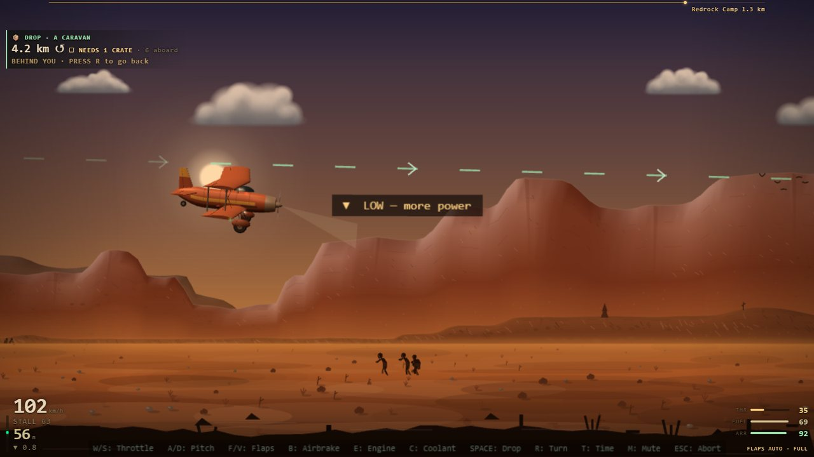
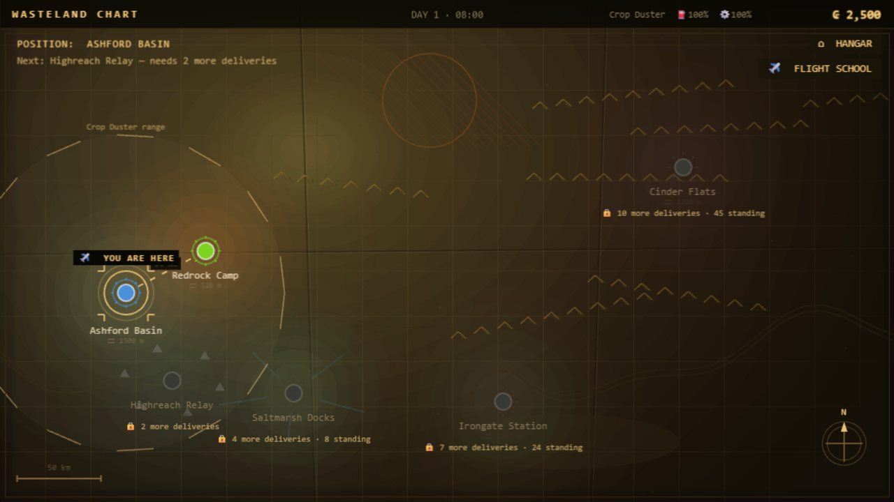
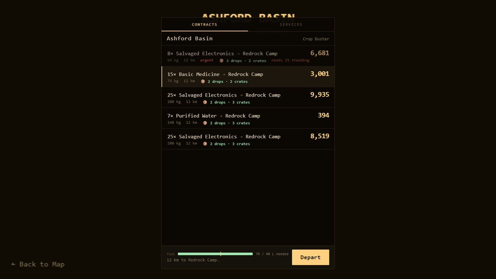

# Ashline Air

**Cargo pilots at the end of the world.** A side-on flying game that runs in your browser: take contracts from settlement dispatch boards, fly old aeroplanes across a ruined wasteland, drop supplies to survivors on the way, and put it down on a short dirt strip at the far end.



## What you do

- **Fly contracts.** Each settlement's board offers cargo, passenger, urgent and discreet jobs. Pick one your aeroplane can carry and land at, depart, deliver it in one piece, and get paid.
- **Fly it properly.** The flight model is simple to pick up but real underneath: throttle, pitch, flaps, gear, airbrakes, engine heat and fuel all matter. Slow down for the flaps, get the gear up after take-off, and flare before the wheels touch.
- **Help people on the way.** Camps, rooftops and town squares along the route signal for crates. Get down into the drop band and press Space at the right moment.
- **Survive the route.** Raider guns, storms, dust walls, icing, lightning, power lines and other traffic in the sky.
- **Build up.** Earn money and reputation, unlock new destinations, and work up from a crop duster to a bush plane, a regional freighter and a military transport.
- **Learn to fly first.** A three-lesson flight school covers take-off and climb, speed control, and landing with flaps. The contract board opens once you've passed it.

| The wasteland chart | A dispatch board |
|---|---|
|  |  |

## Controls

| Action | Keyboard | Touch |
|---|---|---|
| Throttle up / down | W / S | Throttle lever (left) |
| Nose up / down | A / D | NOSE UP / NOSE DN |
| Start engine | E | START |
| Flaps down / up | F / V | FLAP ▼ / FLAP ▲ |
| Landing gear | G | GEAR |
| Airbrakes | B | AIRBRAKE |
| Drop a supply crate | Space | DROP |
| Turn around | R | TURN |
| Speed up time | T | TIME |
| Dump coolant (once per flight) | C | COOLANT |
| Mute | M | |
| Pause / abort | Esc | ☰ |

Flaps are automatic until you touch F or V. On a phone, play in landscape.

## Running it locally

You need [Node.js](https://nodejs.org/) 20.19+ or 22.12+.

```bash
git clone https://github.com/HarisAli-git/Flight-Arcade.git
cd Flight-Arcade
npm install
npm run dev
```

Then open http://localhost:5173.

### Building for the web

```bash
npm run build     # type-checks, then writes a static site to dist/
npm run preview   # serves dist/ locally to try it
```

`dist/` is plain static files with relative paths, so it can be hosted anywhere, including a subfolder such as a GitHub Pages project site.

## How it's made

- **TypeScript**, **[Phaser 3](https://phaser.io/)** for the game and **React 19** for the HUD and menus, built with **[Vite](https://vite.dev/)**.
- No image or sound files: the aircraft are drawn by a small 3D renderer, the world is generated, and every sound is synthesised with the Web Audio API.
- Progress is saved in your browser, with separate pilot profiles. No account, no server.

```
src/
  game/        Phaser scenes, the flight model, the world, audio, flight school
  ui/          React HUD, dispatch board, hangar and other screens
  services/    saves, contracts, economy and progression
  types/       shared types
public/data/   aircraft, goods, settlements, factions and flight events (JSON)
```

Aircraft, settlements and goods are plain JSON in `public/data/`, so they're easy to tweak.
